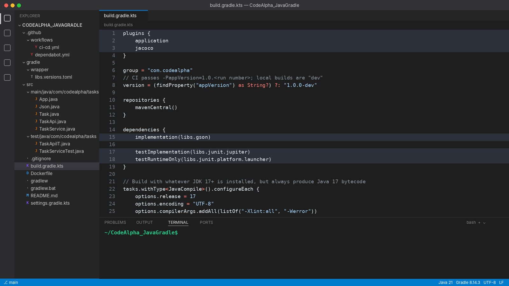
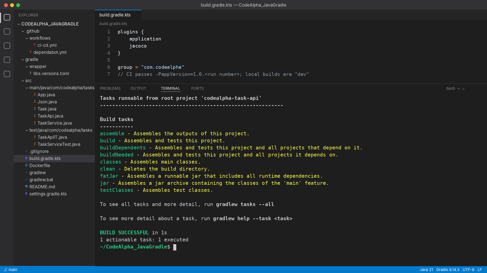
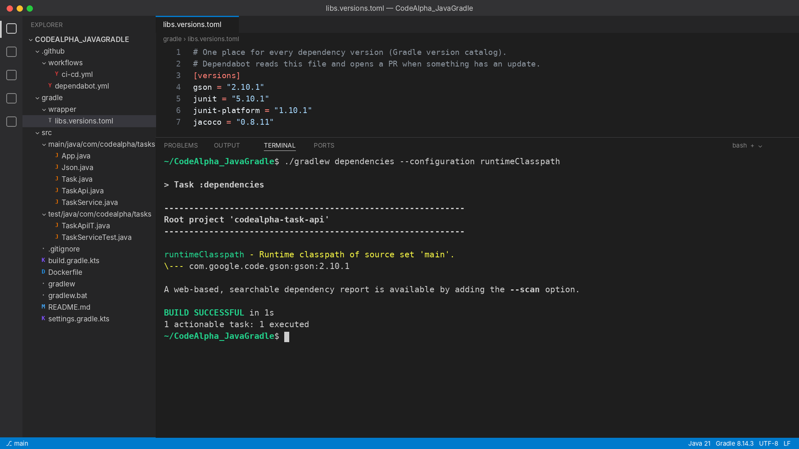
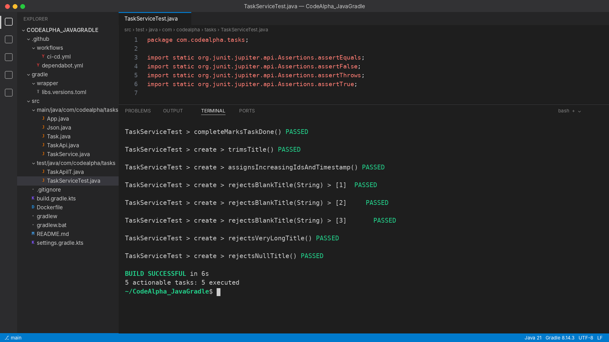
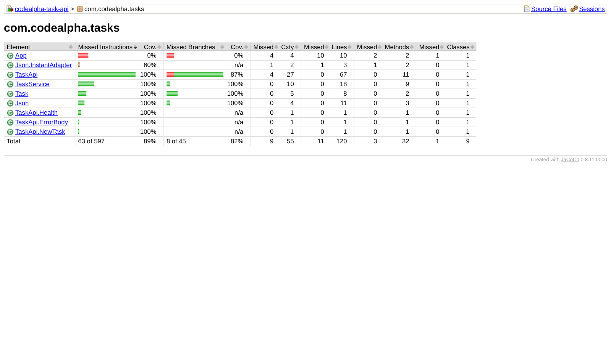
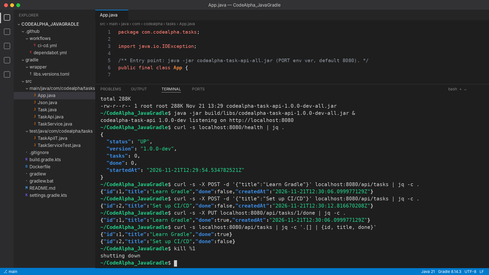
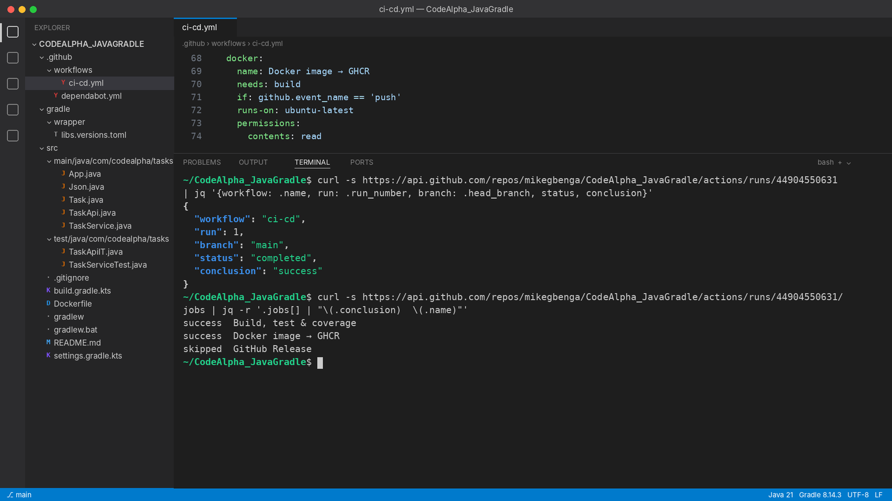

This is the fourth and last project from my CodeAlpha DevOps internship. The task: automate a Java project's build with Gradle, manage its dependencies properly, add CI/CD for continuous delivery, and keep building and deploying simple.

**Repo:** [github.com/mikegbenga/CodeAlpha_JavaGradle](https://github.com/mikegbenga/CodeAlpha_JavaGradle)

## What I built

A small to-do list REST API in plain Java 17+. It uses the HTTP server that comes with the JDK, so there's no big framework, and **Gson** is the only library it needs at runtime.

| Method | Path | What it does |
|---|---|---|
| GET | `/health` | Status, version, task counts |
| GET | `/api/tasks` | List tasks |
| POST | `/api/tasks` | `{"title":"…"}` creates a task (201) |
| GET | `/api/tasks/{id}` | One task (404 if missing) |
| PUT | `/api/tasks/{id}/done` | Mark done |
| DELETE | `/api/tasks/{id}` | Delete (204) |

The app is kept small on purpose, because the point of this task is the build and the pipeline around it.

## The Gradle setup



### The wrapper

The repo includes the Gradle wrapper (`gradlew`, `gradlew.bat` and `gradle/wrapper/`). Anyone who clones it runs `./gradlew build` and gets exactly Gradle 8.14.3, with no Gradle install needed. CI uses the same wrapper, so "works on my machine" and "works in CI" are the same build.



### Dependencies in one place

All versions live in a **version catalog**, `gradle/libs.versions.toml`:

```toml
[versions]
gson = "2.10.1"
junit = "5.10.1"
junit-platform = "1.10.1"
jacoco = "0.8.11"

[libraries]
gson = { module = "com.google.code.gson:gson", version.ref = "gson" }
junit-jupiter = { module = "org.junit.jupiter:junit-jupiter", version.ref = "junit" }
junit-platform-launcher = { module = "org.junit.platform:junit-platform-launcher", version.ref = "junit-platform" }
```

So the dependency block in `build.gradle.kts` stays short:

```kotlin
dependencies {
    implementation(libs.gson)

    testImplementation(libs.junit.jupiter)
    testRuntimeOnly(libs.junit.platform.launcher)
}
```

Using the right scope matters. `implementation` ends up in the app, while `testImplementation` and `testRuntimeOnly` are only used for tests. The runtime dependency tree shows just Gson:



I also added `.github/dependabot.yml`. It reads the version catalog and opens a pull request when something has an update. It opened a few within minutes of my first push, which was a nice confirmation it works. Some of them are big version jumps (Gradle 9, a newer Java base image), so I'll review those properly instead of merging them blindly.

### Compiler settings

```kotlin
tasks.withType<JavaCompile>().configureEach {
    options.release = 17
    options.encoding = "UTF-8"
    options.compilerArgs.addAll(listOf("-Xlint:all", "-Werror"))
}
```

`release = 17` means it builds Java 17 bytecode even on a newer JDK. `-Werror` turns every compiler warning into an error, so warnings get fixed instead of piling up. One to watch for on JDK 21 is `this-escape`, which fires when a constructor hands out references to `this` (my server class registers its own methods as route handlers). Making the class `final` keeps it quiet.

## Tests and a coverage gate

There are 18 tests with JUnit 5:

- `TaskServiceTest`: unit tests, using `@Nested` groups and a `@ParameterizedTest` for blank titles. A fixed `Clock` makes timestamps predictable.
- `TaskApiIT`: starts the **real HTTP server on a random port** and calls it with Java's `HttpClient`. It goes through the full create → read → mark done → delete → 404 flow, plus bad input and wrong methods.

```kotlin
tasks.test {
    useJUnitPlatform()
    testLogging { events("passed", "skipped", "failed") }
    finalizedBy(tasks.jacocoTestReport)
}
```



Then **JaCoCo** measures coverage, and `check` fails the build if it drops below 80%:

```kotlin
tasks.jacocoTestCoverageVerification {
    violationRules {
        rule {
            limit { minimum = "0.80".toBigDecimal() }
        }
    }
}

tasks.check {
    dependsOn(tasks.jacocoTestCoverageVerification)
}
```

Right now it's at about 91% of lines and 82% of branches.



## Packaging: a single runnable jar

The normal `jar` task doesn't include Gson, so `java -jar` would fail. I added a `fatJar` task that puts everything in one file:

```kotlin
val fatJar by tasks.registering(Jar::class) {
    group = "build"
    archiveClassifier = "all"
    duplicatesStrategy = DuplicatesStrategy.EXCLUDE
    manifest.from(tasks.jar.get().manifest)
    from(sourceSets.main.get().output)
    from(configurations.runtimeClasspath.map { cp -> cp.map { if (it.isDirectory) it else zipTree(it) } })
}

tasks.assemble {
    dependsOn(fatJar)
}
```

Running it and trying the API with curl:



The version comes from a Gradle property, `-PappVersion=…`. Locally it's `1.0.0-dev`; in CI it's `1.0.<run number>`, and `/health` reports it.

## Docker

Two stages. The first builds the jar with the wrapper. The build files are copied before the source code, so the dependency download is cached as its own layer. The second stage only has a small Java runtime and the jar.

```dockerfile
FROM eclipse-temurin:21-jdk AS build
WORKDIR /src
COPY gradlew settings.gradle.kts build.gradle.kts gradle.properties ./
COPY gradle ./gradle
RUN chmod +x gradlew && ./gradlew --no-daemon dependencies --configuration runtimeClasspath > /dev/null
COPY src ./src
ARG APP_VERSION=1.0.0-dev
RUN ./gradlew --no-daemon fatJar -PappVersion=${APP_VERSION} && cp build/libs/*-all.jar /src/app.jar

FROM eclipse-temurin:21-jre-alpine AS runtime
RUN addgroup -S app && adduser -S -G app -u 10001 app
WORKDIR /app
COPY --from=build --chown=app:app /src/app.jar ./app.jar
USER 10001
EXPOSE 8080
HEALTHCHECK --interval=30s --timeout=3s --start-period=10s --retries=3 \
  CMD ["wget", "-q", "--spider", "http://127.0.0.1:8080/health"]
ENTRYPOINT ["java", "-XX:MaxRAMPercentage=75", "-jar", "/app/app.jar"]
```

## CI/CD with GitHub Actions

`.github/workflows/ci-cd.yml` has three jobs:

**1. Build, test & coverage** (every push and PR)

```yaml
- uses: gradle/actions/wrapper-validation@v4   # make sure gradle-wrapper.jar is genuine
- uses: actions/setup-java@v4
  with: { distribution: temurin, java-version: '21' }
- uses: gradle/actions/setup-gradle@v4          # caches dependencies between runs
- run: ./gradlew build -PappVersion=1.0.${{ github.run_number }}
```

It also writes a coverage table to the run summary and uploads the jar and the HTML reports as artifacts.

**2. Docker image → GHCR** (pushes only). It builds the image, pushes it to `ghcr.io/mikegbenga/codealpha-task-api` with `latest`, `1.0.<run>` and a commit-SHA tag, then **runs the pushed image and smoke-tests it**: it checks `/health`, creates a task, and confirms the version matches the run.

**3. GitHub Release** (tags like `v1.0.0` only). It attaches the jar to a release.

The first run on `main` went green:



The release job shows as skipped because it only runs on a version tag.

## How to run it

```bash
git clone https://github.com/mikegbenga/CodeAlpha_JavaGradle.git
cd CodeAlpha_JavaGradle
./gradlew build          # Windows: gradlew.bat build
./gradlew run            # http://localhost:8080
curl localhost:8080/health
```

Or with Docker:

```bash
docker run --rm -p 8080:8080 ghcr.io/mikegbenga/codealpha-task-api:latest
```

## What I learned

- The wrapper and the version catalog keep the build identical everywhere.
- Putting the coverage check inside `check` means weak tests fail the build instead of slipping through.
- `-Werror` is strict, but it keeps the build free of warnings.
- Copying the build files before the source in the Dockerfile makes rebuilds much faster.
- With the pipeline in place, every push is built, tested and packaged without me doing anything.

That's the end of the series. Thanks for reading, and thanks to [CodeAlpha](https://www.codealpha.tech) for the internship.
